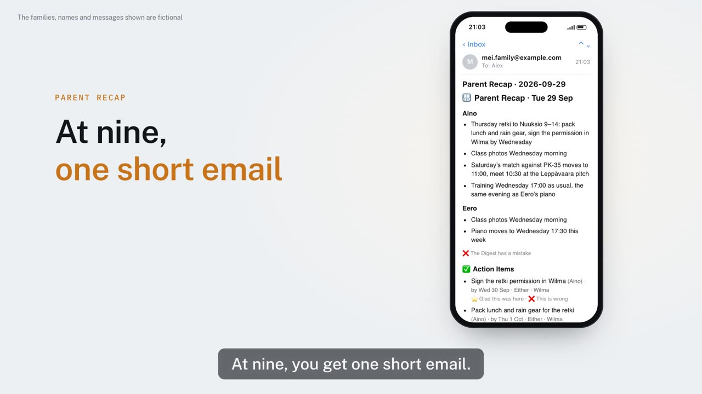

# Kinlace Parent Recap

[English](README.md) · **Suomi** · [简体中文](README.zh-CN.md)

Joka ilta yksi lyhyt sähköposti lastesi koulusta ja harrastuksista: mitä pitää tietää, mitä tehdä ja mihin mennessä.

[](https://parentrecap.com/?lang=fi#demo)

▶ [Katso minuutin esittelyvideo](https://parentrecap.com/?lang=fi#demo) (englanniksi) sivulla [parentrecap.com](https://parentrecap.com/?lang=fi)

Joka ilta Parent Recap lukee paikat, joista lastesi asiat tulevat, antaa oman Claudesi tai ChatGPT:si kirjoittaa lyhyen koosteen ja lähettää sen sähköpostilla sinulle ja kumppanillesi, kummallekin omalla kielellään:

- **Wilma**: koulun viestit, tiedotteet ja seuraavan koulupäivän lukujärjestys
- **WhatsApp**: valitsemasi vanhempien, joukkueiden ja harrastusten ryhmät
- **MyClub**: seuran harjoitusten ja otteluiden kalenteri
- **Gmail**: valitsemiesi koulujen, opettajien ja seurojen sähköpostit

Kooste on ryhmitelty lapsittain, ja siinä ovat hoidettavat asiat määräaikoineen. Uudet tapahtumat tulevat kalenteriliitteenä, jonka lisäät kalenteriisi yhdellä napautuksella.

- Maksuton ja avointa lähdekoodia
- Toimii omalla Macillasi tai Windows-tietokoneellasi, Claude-tilauksellasi tai millä tahansa ChatGPT-tilauksella, ilmaisellakin
- Käyttöönotto vie noin 10 minuuttia, ja ensimmäinen kooste tulee jo käyttöönoton aikana

## Asennus

Avaa Macilla Pääte (paina ⌘-välilyönti, kirjoita Pääte ja paina Enter), liitä tämä rivi ja paina Enter:

```bash
bash -c "$(curl -fsSL https://raw.githubusercontent.com/kinlace/parent-recap/stable/get.sh)"
```

Avaa Windows 11 -tietokoneella PowerShell (paina Windows-näppäintä, kirjoita PowerShell ja paina Enter) ja liitä sen sijaan tämä rivi:

```powershell
irm https://raw.githubusercontent.com/kinlace/parent-recap/stable/install.ps1 | iex
```

Selaimeen aukeaa asetussivu, joka opastaa loput suomeksi, englanniksi tai kiinaksi. Pidä Pääte- tai PowerShell-ikkuna auki, kunnes käyttöönotto on valmis.

Tietokoneen täytyy olla noin klo 21 päällä tai lepotilassa, ja sinun täytyy olla kirjautuneena. Eikö sinulla ole sellaista tietokonetta? Ylläpitäjät ajavat Parent Recapia muutamalle kutsutulle perheelle, ja silloin se lukee vain Wilmaa ja MyClubia.

Lisää ohjeessa [Installing Parent Recap](docs/install.md) (englanniksi): mitä tarvitset, ylläpidetty versio, muut asennustavat, päivittäminen ja poistaminen. [On Windows](docs/windows.md) (englanniksi) kertoo, mikä Windowsilla on toisin.

## Yksityisyys

- Parent Recap toimii omalla tietokoneellasi. Sen ainoa palvelin on ylläpitäjien yhdyskäytävä, joka lähettää koosteen osoitteesta `brief@parentrecap.com` eikä säilytä siitä kopiota. Jos koosteen kirjoittaa Claude tai ChatGPT ja olet yhdistänyt Gmailin, voit lähettää sen sen sijaan omasta Gmailistasi, jolloin palvelintamme ei käytetä lainkaan
- Salasanat, myös Wilman, pysyvät tietokoneesi omassa salasanasäilössä: Macilla avainnipussa, Windowsissa tunnistetietojen hallinnassa
- Gmailista luetaan vain valitsemiesi lähettäjien viestit, ja sen kautta lähetetään kooste vain, jos itse valitset niin; WhatsAppista säilytetään vain valitsemasi ryhmät
- Jokainen kooste ja viestit, joista se tehtiin, arkistoidaan tietokoneellesi kansioon `~/ParentRecap/`

Mihin kaikki tiedot menevät ja missä kukin salasana on: [SECURITY.md](SECURITY.md) (englanniksi).

## Mitä tekoäly näkee

Oma Claudesi tai ChatGPT:si kirjoittaa koosteen. Ennen kuin mitään lähtee tietokoneeltasi:

- Muiden ihmisten nimet, puhelinnumerot, sähköpostiosoitteet ja linkit korvataan paikkamerkeillä, ja lapsesi näkyvät nimillä Kid A ja Kid B. Tietokoneesi palauttaa oikeat tiedot, joten koosteesi näyttää samalta
- Arkaluonteisilta näyttävät viestit, kuten diagnoosia, erityistä tukea, kiusaamista tai lastensuojelua koskevat, eivät mene tekoälylle lainkaan. Kooste kertoo, mistä ne voi lukea

Tämä vähentää sitä, mitä tekoäly saa, mutta ei takaa mitään: muu osa jokaisesta viestistä menee silti sille. Claude ja ChatGPT käsittelevät tiedot Yhdysvalloissa ja voivat oletuksena käyttää niitä mallien kouluttamiseen. Sen voi kytkeä pois Clauden kohdasta Settings > Privacy > "Help improve Claude" tai ChatGPT:n kohdasta Settings > Data controls > "Improve the model for everyone". Lisätietoja: [What the AI sees](docs/config.md#what-the-ai-sees) (englanniksi).

## Usein kysyttyä

<a id="change-settings"></a>

### Miten muutan asetuksia myöhemmin?

Avaa Parent Recap Settings: Macilla etsi se Spotlightilla (Komento-välilyönti), Windowsissa löydät sen Käynnistä-valikosta. Asetussivu aukeaa, ja siellä voit muuttaa, kuka koosteen saa, mihin aikaan se tulee, WhatsApp-ryhmät ja lähteet. Asetuksesi säilyvät.

Tai liitä kohdan [Asennus](#asennus) rivi uudelleen: Macilla Päätteeseen, Windowsissa PowerShelliin. Tai kirjoita Claude Codessa `/parent-recap:manage` tai Codexissa `$parent-recap-manage`, tai kerro vain, mitä haluat muuttaa.

## Kiitokset

Parent Recap lukee Wilmaa Antti Karjalaisen [wilma CLI:n](https://github.com/aikarjal/wilmai) (WilmAI) avulla. Se on ilmaista ja avointa lähdekoodia MIT-lisenssillä. Ilman sitä koosteessa ei olisi Wilmaa.

## Vastuuvapauslauseke

Avoimen lähdekoodin työkalu, jonka vanhemmat ovat tehneet omaan käyttöönsä. Sillä ei ole yhteyttä Vismaan (Wilma), Eepokseen, myClubiin, Metaan (WhatsApp) tai Googleen, eivätkä ne ole hyväksyneet sitä. Wilmaa luetaan epävirallisella, yhteisön ylläpitämällä [wilma CLI:llä](https://github.com/aikarjal/wilmai). Jos jokin lähde lakkaa toimimasta, ota yhteyttä Parent Recapin tai wilma CLI:n ylläpitäjiin, älä näihin yrityksiin.

Osallistumisesta kertoo [CONTRIBUTING.md](CONTRIBUTING.md) (englanniksi). Tietoturvaongelman voi ilmoittaa luottamuksellisesti [SECURITY.md](SECURITY.md#reporting-a-security-problem):n ohjeen mukaan (englanniksi). Lisenssi: [MIT](LICENSE).
