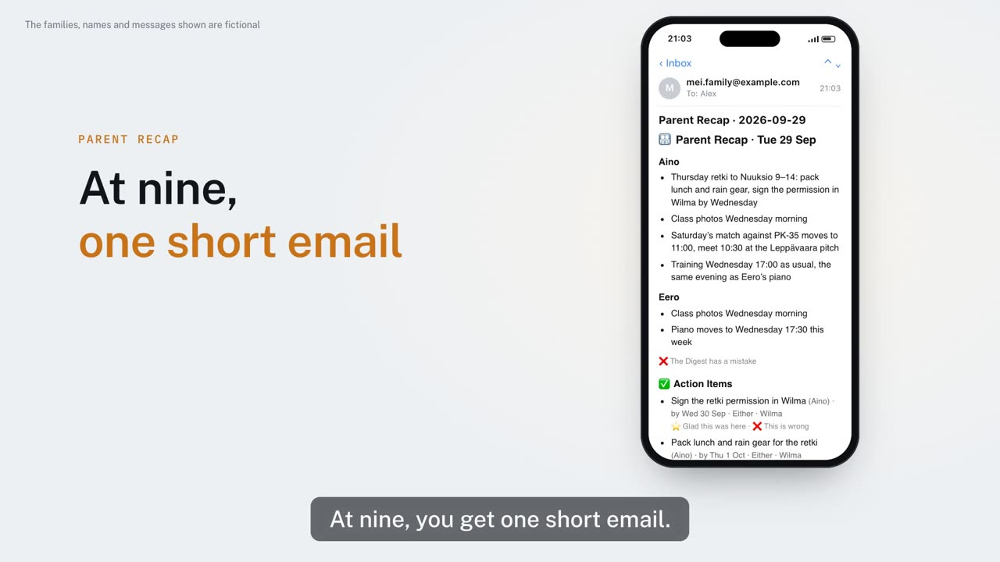

# Kinlace Parent Recap

**English** · [Suomi](README.fi.md) · [简体中文](README.zh-CN.md)

One short email every evening about your kids' school and clubs: what to know, what to do, and by when.

[](https://parentrecap.com/?lang=en#demo)

▶ [Watch the 1-minute demo](https://parentrecap.com/?lang=en#demo) on [parentrecap.com](https://parentrecap.com/?lang=en)

Every evening Parent Recap reads the places your kids' news comes from, has your own Claude or ChatGPT write a short Brief, and emails it to you and your partner, each in your own language:

- **Wilma**: school messages, announcements and the next school day's timetable
- **WhatsApp**: the parent, team and hobby groups you pick
- **MyClub**: the club's training and match calendar
- **Gmail**: mail from the schools, teachers and clubs you pick

The Brief is grouped by Kid, with Action Items and their due dates. New events come as a calendar attachment you add with one tap.

- Free and open source
- Runs on your own Mac or Windows PC, with your Claude subscription or any ChatGPT plan, Free included
- Setup takes about 10 minutes, and your first Brief arrives during setup

## Install

On a Mac, open Terminal (press ⌘Space, type Terminal and press Enter), paste this line and press Enter:

```bash
bash -c "$(curl -fsSL https://raw.githubusercontent.com/kinlace/parent-recap/stable/get.sh)"
```

On a Windows 11 PC, open PowerShell (press the Windows key, type PowerShell and press Enter) and paste this line instead:

```powershell
irm https://raw.githubusercontent.com/kinlace/parent-recap/stable/install.ps1 | iex
```

A setup page opens in your browser and walks you through the rest in Finnish, English or Chinese. Keep the Terminal or PowerShell window open until setup is done.

The computer needs to be on or asleep around 9 pm, with you logged in. No computer like that? The maintainers host Parent Recap for a few invited families, reading Wilma and MyClub only.

More in [Installing Parent Recap](docs/install.md): what you need, the hosted version, other ways to install, updating and uninstalling. [On Windows](docs/windows.md) says what differs there.

## Privacy

- Parent Recap runs on your own computer. Its only server is the maintainers' gateway, which sends the Brief from `brief@parentrecap.com` and keeps no copy. If Claude or ChatGPT writes your Brief and you connected Gmail, you can send it from your own Gmail instead, and then no server of ours is used
- Passwords, Wilma's included, stay in your computer's own password store: the Keychain on a Mac, Credential Manager on Windows
- Gmail is read only for mail from the senders you pick, and sends the Brief only if you choose that; WhatsApp only keeps the groups you pick
- Every Brief and the messages it came from are archived on your computer, in `~/ParentRecap/`

Where all data goes and where each password lives: [SECURITY.md](SECURITY.md).

## What the AI sees

Your own Claude or ChatGPT writes the Brief. Before anything leaves your computer:

- Other people's names, phone numbers, email addresses and links become placeholders, and your Kids go as Kid A and Kid B. Your computer puts the real ones back, so your Brief looks the same
- Messages that look sensitive, such as ones about a diagnosis, special support, bullying or child welfare, don't reach the AI at all. The Brief says where to read them

This cuts down what the AI gets and guarantees nothing: the rest of each message still reaches it. Claude and ChatGPT process it in the US, and by default may use it to train their models. Turn that off under "Help improve Claude" in Claude's Settings > Privacy, or "Improve the model for everyone" in ChatGPT's Settings > Data controls. The details are in [What the AI sees](docs/config.md#what-the-ai-sees).

## FAQ

<a id="change-settings"></a>

### How do I change a setting later?

Open Parent Recap Settings: on a Mac, search for it with Spotlight (Command-Space); on Windows, find it in the Start menu. The setup page opens, and there you change who gets the Brief, its time, the WhatsApp groups and the Sources. Your settings are kept.

Or paste the install line from [Install](#install) again: in Terminal on a Mac, in PowerShell on Windows. Or, in Claude Code type `/parent-recap:manage`, in Codex `$parent-recap-manage`, or just say what you want to change.

## Thanks

Parent Recap reads Wilma through Antti Karjalainen's [wilma CLI](https://github.com/aikarjal/wilmai) (WilmAI), free and open source under MIT. Without it there would be no Wilma in the Brief.

## Disclaimer

An open-source tool made by parents for their own use, not affiliated with or endorsed by Visma (Wilma), Eepos, myClub, Meta (WhatsApp) or Google. Wilma is read through the unofficial, community-maintained [wilma CLI](https://github.com/aikarjal/wilmai). If a Source stops working, contact the maintainers of Parent Recap or the wilma CLI, not these companies.

To contribute, see [CONTRIBUTING.md](CONTRIBUTING.md). To report a security problem privately, see [SECURITY.md](SECURITY.md#reporting-a-security-problem). Licensed under [MIT](LICENSE).
