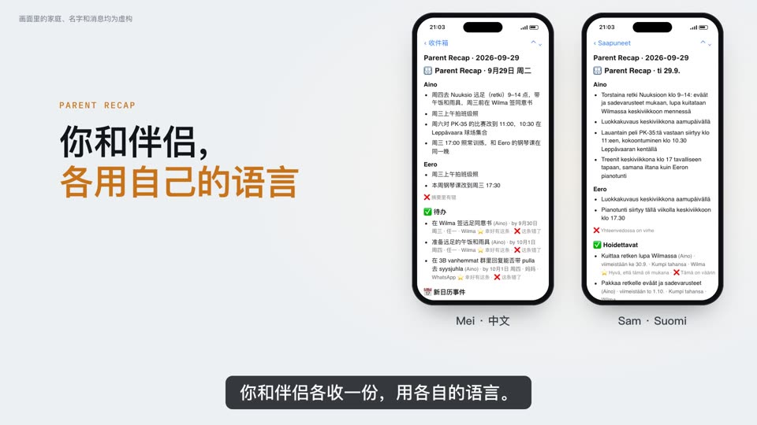

# Parent Recap

<sub>由 Kinlace 出品</sub>

[English](README.md) · [Suomi](README.fi.md) · **简体中文**

每天晚上一封简短的邮件，告诉你孩子学校和兴趣班的事：要知道什么，要做什么，什么时候之前做。

[](https://parentrecap.com/?lang=zh#demo)

▶ 在 [parentrecap.com](https://parentrecap.com/?lang=zh) 上[看 1 分钟中文演示视频](https://parentrecap.com/?lang=zh#demo)

每天晚上，Parent Recap 读取孩子的各种消息来源，让你自己的 Claude 或 ChatGPT 写一份简短的日报，用邮件发给你和伴侣，各用自己的语言：

- **Wilma**：学校的消息、公告和下一个上学日的课表
- **WhatsApp**：你选的家长群、球队群和兴趣班群；你选的群还可以在日报里用几行总结群里的其他讨论
- **MyClub**：俱乐部的训练和比赛日历
- **Gmail**：你选的学校、老师和俱乐部发来的邮件

日报按孩子分组，列出待办和截止日期。新的活动作为日历附件发来，点一下就能加进日历。

- 免费、开源
- 在你自己的 Mac 或 Windows 电脑上运行，用你的 Claude 订阅或任何 ChatGPT 账号，免费版也行
- 设置大约 10 分钟，设置过程中就能收到第一份日报

## 安装

在 Mac 上，打开“终端”（按 ⌘空格，输入 Terminal 再按回车），粘贴这一行，按回车：

```bash
bash -c "$(curl -fsSL https://raw.githubusercontent.com/kinlace/parent-recap/stable/get.sh)"
```

在 Windows 11 电脑上，打开 PowerShell（按 Windows 键，输入 PowerShell 再按回车），改为粘贴这一行：

```powershell
irm https://raw.githubusercontent.com/kinlace/parent-recap/stable/install.ps1 | iex
```

浏览器会打开一个设置页面，用芬兰语、英语或中文带你完成剩下的步骤。设置完成之前，请不要关掉终端或 PowerShell 窗口。

每天晚上 9 点左右，这台电脑需要开着或在睡眠中，并且你保持登录。没有这样的电脑？维护者为少数受邀家庭托管运行 Parent Recap，只读 Wilma 和 MyClub。

更多内容见[安装 Parent Recap](docs/install.md)（英文）：需要什么、托管版、其他安装方式、更新和卸载。[Windows 版](docs/windows.md)（英文）说明 Windows 上有哪些不同。

## 隐私

- Parent Recap 在你自己的电脑上运行。它唯一的服务器是维护者的网关，用 `brief@parentrecap.com` 发出日报，不保留副本。如果日报由 Claude 或 ChatGPT 写，而且你连接了 Gmail，也可以改用你自己的 Gmail 发，这样就完全不经过我们的服务器
- 密码（包括 Wilma 的）存在电脑自带的密码库里：Mac 上是钥匙串，Windows 上是凭据管理器
- Gmail 只读你选的发件人的邮件，只有你自己选了才会用它发日报；WhatsApp 只保留你选的群
- 每份日报和它依据的消息都存档在你的电脑上，在 `~/ParentRecap/` 里

所有数据去了哪里、每个密码存在哪里，见 [SECURITY.md](SECURITY.md)（英文）。

## AI 看到什么

日报由你自己的 Claude 或 ChatGPT 来写。任何内容离开你的电脑之前：

- 别人的名字、电话号码、邮箱地址和链接会换成占位符，你的孩子以 Kid A、Kid B 出现。你的电脑会把真实内容换回来，所以你收到的日报看起来一样
- 看起来敏感的消息，比如关于诊断、特殊支持、霸凌或儿童保护的消息，完全不交给 AI。日报会告诉你去哪里看这些消息

这能减少 AI 拿到的内容，但不能保证什么：每条消息的其余部分仍然会交给它。Claude 和 ChatGPT 在美国处理这些内容，并且默认可能用它训练模型。要关掉的话：在 Claude 的 Settings > Privacy 里关掉“Help improve Claude”，或在 ChatGPT 的 Settings > Data controls 里关掉“Improve the model for everyone”。详情见 [What the AI sees](docs/config.md#what-the-ai-sees)（英文）。

## 常见问题

<a id="change-settings"></a>

### 以后怎么修改设置？

打开 Parent Recap Settings：Mac 上用“聚焦搜索”（Command-空格）搜它，Windows 上在“开始”菜单里找到它。设置页面会打开，在那里可以修改谁收日报、几点收、WhatsApp 群和信息源。你原来的设置都会保留。

也可以再粘贴一次[安装](#安装)里的那一行：Mac 上粘贴到“终端”，Windows 上粘贴到 PowerShell。或者，在 Claude Code 里输入 `/parent-recap:manage`，在 Codex 里输入 `$parent-recap-manage`，或者直接说你想改什么。

### 晚上笔记本合着盖子，为什么日报第二天早上才到？

电脑会为日报醒来，但合上盖子的笔记本（尤其是用电池时）可能在日报写完之前又睡着。那样日报会在你下次打开笔记本时完成，并在开头说明这一点。内容不会少：它照样是那天晚上的日报。如果你想每天晚上准时收到日报，又不想让电脑一直开着，可以问维护者托管版的事（见[安装](#安装)）。

## 致谢

Parent Recap 通过 Antti Karjalainen 的 [wilma CLI](https://github.com/aikarjal/wilmai)（WilmAI）读取 Wilma，它免费开源，采用 MIT 许可。没有它，摘要里就没有 Wilma 的内容。

## 免责声明

这是家长们为自己做的开源工具，与 Visma（Wilma）、Eepos、myClub、Meta（WhatsApp）和 Google 没有关联，也没有得到它们的认可。Wilma 通过非官方、由社区维护的 [wilma CLI](https://github.com/aikarjal/wilmai) 读取。如果某个信息源不能用了，请联系 Parent Recap 或 wilma CLI 的维护者，不要联系这些公司。

想参与贡献，见 [CONTRIBUTING.md](CONTRIBUTING.md)（英文）。要私下报告安全问题，见 [SECURITY.md](SECURITY.md#reporting-a-security-problem)（英文）。采用 [MIT](LICENSE) 许可证。
