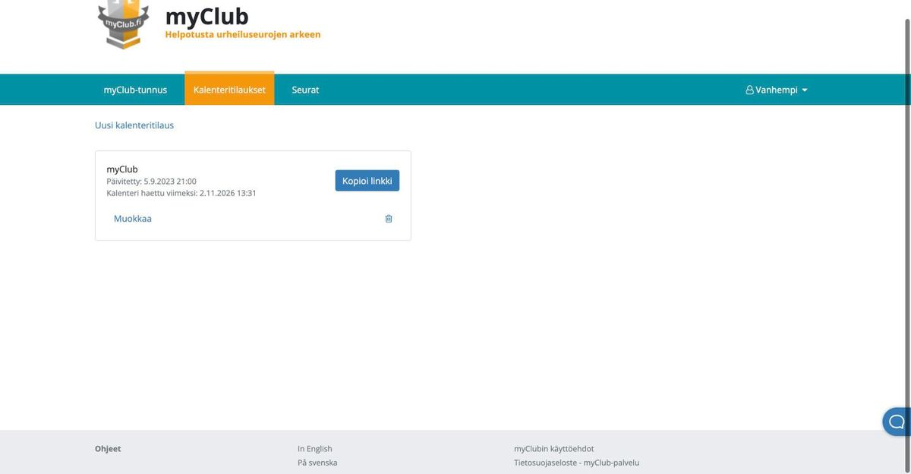
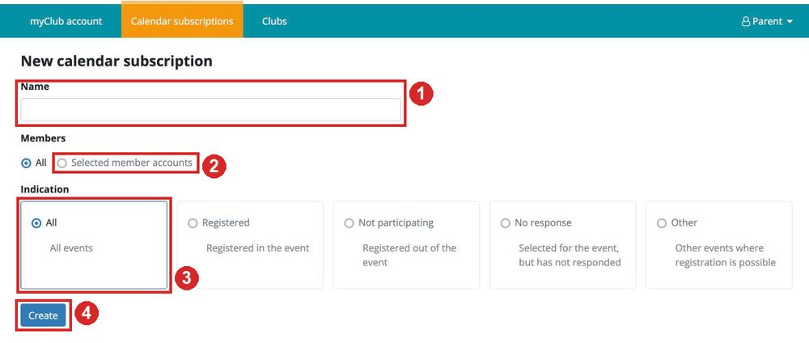
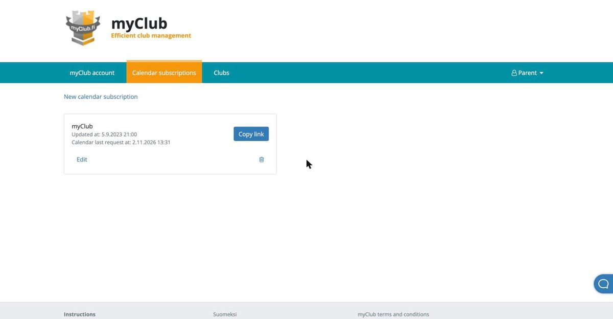
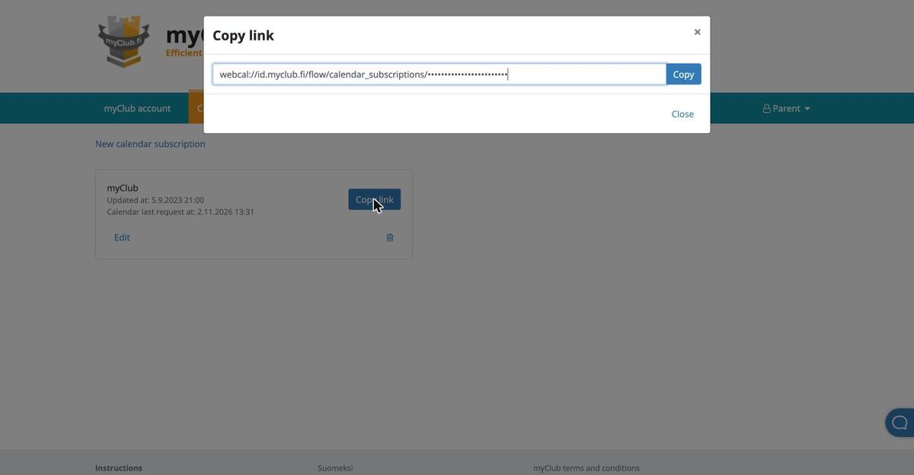

# Your Kid's MyClub calendar link

Parent Recap reads club events from a calendar link that you make once in MyClub. It takes about two minutes on a computer. Each Kid needs their own link. [中文说明在下面](#中文)

## In English

**1. Sign in and switch MyClub to English.** Sign in at [id.myclub.fi](https://id.myclub.fi/flow/login), then open the [New calendar subscription](https://id.myclub.fi/flow/calendar_subscriptions/new) form. MyClub is in Finnish unless you change it: choose **In English** at the bottom of the page.

**2. Fill in the form.** The numbers match the picture.

1. **Name** (Nimi): any name, such as the Kid's. MyClub won't create it without one.
2. **Members** (Jäsentilit): choose **Selected member accounts** (Valitut jäsentilit) and tick only this Kid.
3. **Indication** (Ilmoittautuminen): leave it on **All** (Kaikki). Any other choice leaves out events.
4. Press **Create** (Luo).

**3. Copy the link.** MyClub goes back to your Calendar subscriptions. Press **Copy link** (Kopioi linkki) on the new one.

**4. Paste it into Parent Recap.** Copy the whole link that starts with `webcal://` and paste it in the MyClub step of setup, next to the Kid it's for.

The link holds all of the Kid's groups and teams, so one link per Kid is enough. For a second Kid, make another subscription with only that Kid ticked. Keep the link to yourself: anyone who has it can see the Kid's club calendar.

## 中文

**1. 登录，把 MyClub 切换成英文。** 在 [id.myclub.fi](https://id.myclub.fi/flow/login) 登录，然后打开[新建日历订阅](https://id.myclub.fi/flow/calendar_subscriptions/new)的表单。MyClub 默认是芬兰语，在页面最下方点 **In English** 就能换成英文。

**2. 填表。** 序号和图上的一致。

1. **名称**（Name / Nimi）：随便填，比如孩子的名字。不填 MyClub 不让创建。
2. **成员**（Members / Jäsentilit）：选 **Selected member accounts**（Valitut jäsentilit），只勾这一个孩子。
3. **报名状态**（Indication / Ilmoittautuminen）：保持 **All**（Kaikki）。选别的会漏掉活动。
4. 点 **Create**（Luo）。

**3. 复制链接。** MyClub 会回到日历订阅列表。在刚建好的那一项上点 **Copy link**（Kopioi linkki）。

**4. 粘贴到 Parent Recap。** 复制以 `webcal://` 开头的完整链接，粘贴到设置页 MyClub 那一步，对应的孩子下面。

这一个链接里已经有孩子所有兴趣班和球队的活动，每个孩子一个链接就够了。第二个孩子就再建一个订阅，只勾那个孩子。链接不要发给别人：拿到链接的人都能看到孩子的俱乐部日历。
